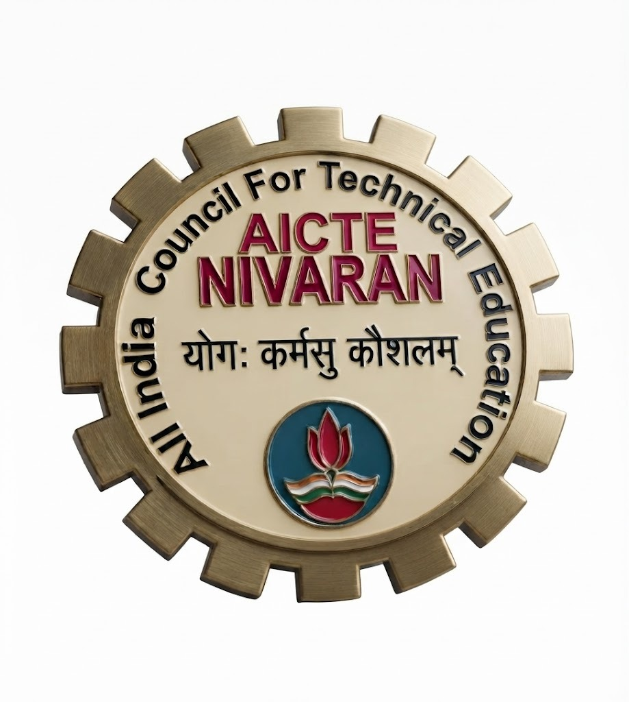
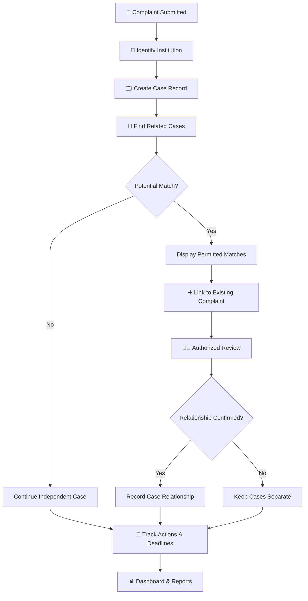
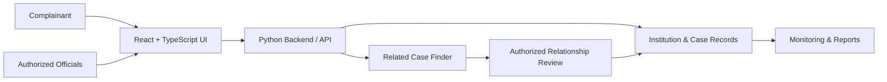

 <div align="center">



# 🇮🇳 AICTE NIVARAN
### एआईसीटीई निवारण

**Reimagining Grievance Coordination Through Intelligent Case Linking**

*Smart India Hackathon 2026 · SIH26264*

[](https://react.dev/)
[](https://www.typescriptlang.org/)
[](https://vite.dev/)
[](https://www.python.org/)

### ONE PLATFORM. CONNECTED COMPLAINTS. ACCOUNTABLE ACTION.

[Overview](#-the-vision) · [Features](#-key-capabilities) · [Innovation](#-our-signature-innovation) · [Architecture](#-how-the-system-works) · [Setup](#-run-locally)

</div>

---

## 🌟 The Vision

**AICTE NIVARAN** is a grievance coordination platform prototype designed around a critical administrative challenge: complaints about the same institution can remain scattered across different departments, making coordination and accountability difficult.

Our approach brings institution profiles, case monitoring, related-complaint discovery, responsibility tracking, and reporting into one coordinated workflow.

> 💡 **Our mission:** Move from isolated complaint handling to connected, transparent, and accountable grievance coordination.

## 🚨 The Challenge We Address

<div align="center">

| 🔴 Fragmented Records | 🟠 Unclear Ownership | 🟡 Delayed Follow-ups |
|:---:|:---:|:---:|
| Related complaints may remain disconnected. | Responsibility and next actions can be difficult to trace. | Pending actions and deadlines may be overlooked. |

</div>

Traditional complaint monitoring can make it difficult to identify patterns across institutions, coordinate departments, and understand the complete status of related cases.

**NIVARAN proposes a unified view to help authorized users coordinate cases without compromising their individual identities.**

## ⚡ Key Capabilities

### 🏛️ Centralized Institution Intelligence
- Institution profiles organized around the AICTE Permanent ID.
- Consolidated views of available institution-related complaint records.
- Institution-wise and region-wise monitoring.

### 🔎 Cross-Bureau Case Discovery
- Identify potentially related complaints using institution identity, text, category, and incident context.
- Display possible matches with relevant reasons.
- Support authorized review before relationships are confirmed.

### 📊 Grievance Monitoring Dashboard
- Track complaint status and assigned departments.
- Surface pending actions, approaching deadlines, and overdue cases where the required data is available.
- Support Bureau-wise, region-wise, and institution-wise reporting.

### 🧭 Accountability and Action History
- Track responsibility, transfers, remarks, and next actions.
- Maintain a chronological record of case activity.
- Support controlled escalation according to approved workflows.

### 🌐 Accessible User Experience
- Clear navigation and structured complaint information.
- Bilingual and accessibility-oriented interface goals.
- Accessibility compliance to be validated through appropriate testing.

## 🚀 Our Signature Innovation

<div align="center">

# ➕ Link to Existing Complaint

### Turning individual reports into coordinated action.

</div>

Imagine a student files a complaint about an institution withholding original certificates. The system discovers a potentially related unresolved complaint.

Instead of forcing the student to start from zero, NIVARAN can present a relevant match for consideration.

**Example — synthetic demonstration data**

| Field | Example |
|---|---|
| Case ID | `PGRC-1042` |
| Issue | Original certificates withheld |
| Status | Under process |
| Suggested action | `+ Link to Existing Complaint` |

### 🔗 How it works

**01 — Discover**  
Search for potentially related unresolved complaints associated with the same institution.

**02 — Display**  
Show permitted matches, summaries, statuses, and relevant departments.

**03 — Link**  
The complainant selects **+ Link to Existing Complaint** to flag a possible relationship.

**04 — Review**  
An authorized officer confirms or rejects the proposed relationship.

**05 — Coordinate**  
Confirmed links support coordination while every complaint retains its own ID, history, ownership, and applicable deadlines.

> **The difference:** Linking does not mean merging. Similarity does not mean proof. Every proposed relationship remains subject to review.

## 🔄 How the System Works



## 🏗️ Proposed System Architecture



*These diagrams describe the intended workflow and architecture; they do not imply that every component or integration is already implemented.*

## 🧰 Technology Stack

| Layer | Technology |
|---|---|
| Frontend | React + TypeScript |
| Build Tool | Vite |
| Backend | Python |
| API Configuration | See `backend/main.py` |
| Dependencies | `frontend/package.json` and `backend/requirements.txt` |
| Frontend Hosting | Vercel |
| Future Matching Options | PostgreSQL full-text search, trigram similarity, or evaluated semantic matching |

The final implementation should be described according to the code and dependencies actually present in the repository.

## 💻 Run Locally

### Prerequisites
- Git
- Node.js and npm
- Python compatible with backend dependencies

### 1. Clone the repository

```bash
git clone https://github.com/AsawariPawar0322/AICTE-NIVARAN.git
cd AICTE-NIVARAN
```

### 2. Start the frontend

```bash
cd frontend
npm install
npm run dev
```

Open the local address displayed in your terminal, commonly `http://localhost:5173/`.

### 3. Start the backend

Open another terminal:

```bash
cd backend
python -m venv .venv
```

Activate the environment.

**Windows PowerShell**

```powershell
.\.venv\Scripts\Activate.ps1
```

**macOS/Linux**

```bash
source .venv/bin/activate
```

Install the backend dependencies:

```bash
pip install -r requirements.txt
```

If `backend/main.py` exposes a FastAPI application named `app`, you can try:

```bash
uvicorn main:app --reload
```

Check `backend/README.md` if the application requires a different startup command or environment configuration.

## 🔐 Privacy, Security & Trust

A grievance platform may process sensitive information. A production implementation should include:

- Role-based access and least-privilege permissions.
- Secure authentication and input validation.
- Private evidence storage.
- Auditable assignment and status changes.
- Human review of uncertain matches and disputed outcomes.
- Appropriate data retention and deletion controls.
- Testing against unauthorized access and information leakage.

Official institution data, internal AICTE integrations, and departmental workflows require authorization. Cryptographic verification, OTP-based closure, and other security-sensitive capabilities should only be claimed as implemented after successful testing.

## 🗺️ Development Roadmap

- [ ] Validate the prototype against mandatory SIH26264 requirements.
- [ ] Test related-case matching against labelled examples.
- [ ] Measure precision and recall.
- [ ] Implement authorized case-link review.
- [ ] Strengthen action history, deadline tracking, and escalation.
- [ ] Integrate approved institution data when access is granted.
- [ ] Test accessibility, security, privacy, and role permissions.
- [ ] Evaluate reporting accuracy and usability.

## 🎯 Expected Impact

NIVARAN aims to help authorized teams:

- Discover potentially related grievances sooner.
- Reduce disconnected handling of related complaints.
- Improve visibility into responsibility and next actions.
- Monitor overdue cases more effectively.
- Support evidence-based coordination and reporting.

These are intended benefits; their actual impact must be measured through evaluation.

## 📌 Problem Statement

**SIH26264 — AICTE Grievance Coordination and Monitoring**

The project focuses on centralized institution-related complaint monitoring, potential overlap detection, responsibility tracking, coordinated action, deadline visibility, and institution-wise and department-wise reporting across AICTE Bureaus and Cells.

## ⚖️ Disclaimer

AICTE NIVARAN is a student project prototype developed in the context of Smart India Hackathon problem statement SIH26264. It is not an official AICTE service and does not imply endorsement by AICTE or the Ministry of Education. Example cases are synthetic and intended for demonstration.

---

<div align="center">

### 🇮🇳 AICTE NIVARAN

**From scattered complaints to connected accountability.**

*योगः कर्मसु कौशलम्*

</div>
