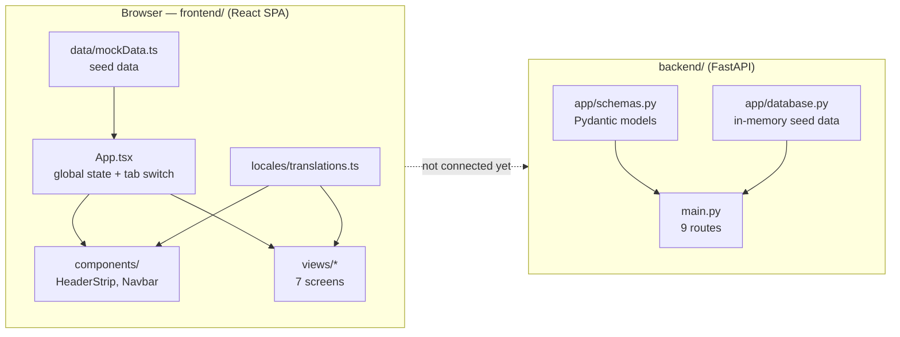
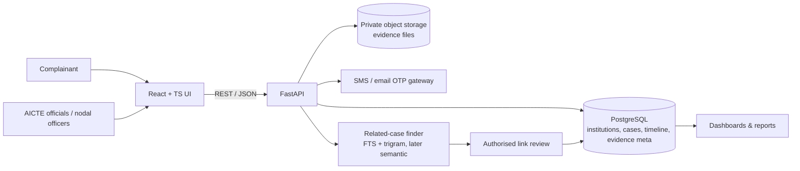

# 02 · Architecture

## Technology stack

| Layer | Technology | Version (from manifests) |
|---|---|---|
| UI framework | React | ^19.3.1 |
| Language | TypeScript | ~6.0.3 |
| Build/dev server | Vite (+ `@vitejs/plugin-react`) | ^8.3.4 |
| Icons | lucide-react | ^1.61.0 |
| Lint | oxlint (react, typescript, oxc plugins) | ^1.88.0 |
| Fonts | Google Fonts: Noto Sans, Noto Sans Devanagari, Noto Sans Mono | — |
| Backend framework | FastAPI | >=0.100 (0.162 installed) |
| ASGI server | Uvicorn | >=0.23 |
| Validation | Pydantic v2 | >=2.0 |
| Data store | In-memory Python lists / React state | — |
| Hosting | Vercel (frontend) | — |

No router, state library, CSS framework, HTTP client, or database is used.

## Current system (as built)



The two halves model the same domain independently. The frontend is what the demo runs on.

## Target system (proposed)



## Frontend architecture

### Single state owner

`App.tsx` owns all application state and passes data and callbacks down as props. Views keep only local UI state (form fields, filters, modals).

| State in `App.tsx` | Type | Initial value | Used by |
|---|---|---|---|
| `lang` | `'en' \| 'hi'` | `'en'` | every component |
| `fontScale` | number | `1.0` | HeaderStrip → `--font-scale` on `<html>` |
| `highContrast` | boolean | `false` | HeaderStrip → `data-high-contrast` on `<html>` |
| `activeRole` | `'complainant' \| 'official'` | `'complainant'` | HeaderStrip, set by LoginView |
| `activeTab` | `ActiveTab` | `'dashboard'` | Navbar, all views (navigation) |
| `currentUser` | profile or `null` | Aarav Sharma | HeaderStrip, set by LoginView |
| `institutions` | `Institution[]` | `mockInstitutions` | LandingPage, FileComplaintView |
| `complaints` | `Complaint[]` | `initialComplaints` | Dashboard, Track, Navbar badge |
| `selectedComplaint` | `Complaint \| null` | first complaint | Track, Chat |
| `selectedInstForComplaint` | `Institution \| null` | `null` | LandingPage → FileComplaintView |
| `chatMessages` | `UserAdminMessage[]` | `initialChatMessages` | Chat |

### Routing

There is no URL routing. `activeTab` selects which view renders inside `<main>`:

| `activeTab` | View |
|---|---|
| `home` | `LandingPage` |
| `dashboard` (default) | `ComplainantDashboard` |
| `file-complaint` | `FileComplaintView` |
| `track` | `TrackComplaintView` |
| `chat` | `UserAdminChatView` (only if `selectedComplaint` is set) |
| `discord` | `DiscordReplicaView` |
| `login` | `LoginView` |

Because each view unmounts when the tab changes, its local state (wizard step, typed text) resets.

### Page layout

```
<div.app-root>
  HeaderStrip   gov banner · language · A-/A/A+ · contrast · role switch · login/logout
  Navbar        tabs · PENDING_OTP badge
  <main>        one view, chosen by activeTab
  <footer>      quick links · statutory cells · Discord button (styles inline in App.tsx)
```

### Styling system

1. `tokens.css` — CSS custom properties on `:root`: brand colours (AICTE orange `#F2895E`, action `#C2570C`, navy `#0B2A5B`, blue `#1F5FBF`), neutrals, status pairs, spacing, radius, `--font-scale`. Also the `[data-high-contrast="true"]` override.
2. `index.css` — imports tokens; base `html/body`, skip-link, `.container`, `.btn*`, `.status-chip`/`.chip-*`, `.card`, `.input-*`, and Tailwind-like utilities (`flex`, `gap-N`, `grid-cols-N`), with a 768 px breakpoint that collapses grids.
3. Each component ends with an inline `<style>{`...`}</style>` block holding its own class rules.

`App.css` is a leftover from the Vite template and is not imported.

### Internationalisation

`locales/translations.ts` exports `translations = { en: {...}, hi: {...} }` (~60 keys each) and `type Language`. Components do `const t = translations[lang]`. Some components also use inline `lang === 'hi' ? '…' : '…'` ternaries.

## Backend architecture

- `main.py` creates `FastAPI(title="AICTE NIVARAN API", version="1.0.0")`, enables CORS for all origins, and defines every route directly (no routers).
- `app/schemas.py` holds the Pydantic request bodies. Responses are plain dicts.
- `app/database.py` holds module-level lists/dicts that routes read and mutate. A restart resets everything.
- Swagger UI is served at `/docs` (FastAPI default).

See [06-api-reference.md](06-api-reference.md).

## Key design decisions

| Decision | Reason | Trade-off |
|---|---|---|
| Frontend runs on mock data | A reliable demo with no server dependency | Not integrated; data duplicated with backend |
| Tab state instead of a router | Fewer dependencies, fast to build | No deep links, back button does nothing |
| Inline per-component CSS | Each screen is self-contained | Large files, no CSS reuse between views |
| Permanent ID as the institution key | Matches AICTE's real identifier | Real data access requires AICTE authorisation |
| OTP closure owned by the complainant | Prevents unilateral closure by institutions | Needs a real SMS gateway in production |
