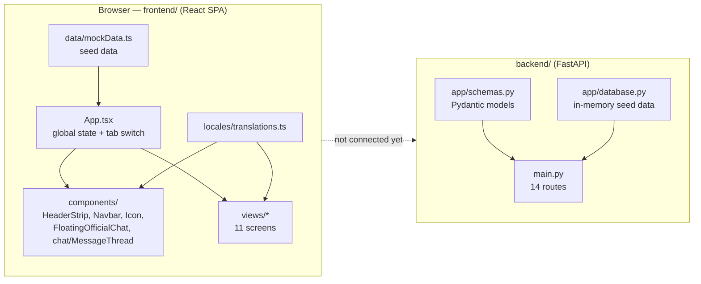
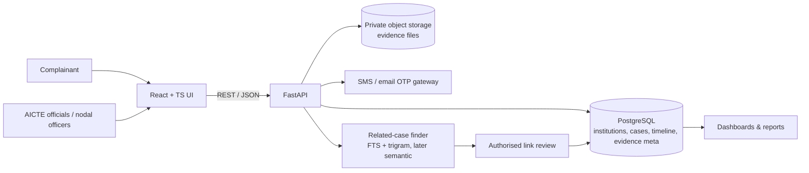

# 02 · Architecture

## Technology stack

| Layer | Technology | Version (from manifests) |
|---|---|---|
| UI framework | React | ^19.3.1 |
| Language | TypeScript | ~6.0.3 |
| Build/dev server | Vite (+ `@vitejs/plugin-react`) | ^8.3.4 |
| Admin Router | react-router-dom (MemoryRouter for Admin) | ^6.28.0 |
| Charts / Analytics | Recharts | ^2.15.4 |
| CSS Utilities | Tailwind CSS (preflight: false) + PostCSS | ^3.4.15 |
| Icons | lucide-react, @phosphor-icons/react (via `components/Icon.tsx`) | ^1.61.0, ^2.1.10 |
| Lint | oxlint (react, typescript, oxc plugins) | ^1.88.0 |
| Fonts | Google Fonts: Noto Sans, Noto Sans Devanagari, Noto Sans Mono | — |
| Backend framework | FastAPI | >=0.100 (0.162 installed) |
| ASGI server | Uvicorn | >=0.23 |
| Validation | Pydantic v2 | >=2.0 |
| Data store | In-memory Python lists / React state | — |
| Hosting | Vercel (frontend) | — |

Routing uses a hybrid architecture: hand-written hash routing (`#home`, `#dashboard`, `#track`) on the citizen side, and an isolated `MemoryRouter` inside `<AdminPortal />` for the 15 enterprise administration modules. Tailwind CSS v3 is enabled with `preflight: false` so it coexists with existing citizen CSS.

## Current system (as built)



The two halves model the same domain independently. The frontend is what the demo runs on.

## Target system (proposed)



## Frontend architecture

### Single state owner

`App.tsx` owns all application state and passes data and callbacks down as props. Views keep only local UI state (form fields, filters, modals).

| State in `App.tsx` | Type | Initial value | Used by |
|---|---|---|---|
| `lang` | `'en' \| 'hi'` | `'en'` | every component |
| `fontScale` | number | `1.0` | HeaderStrip → `--font-scale` on `<html>` |
| `highContrast` | boolean | `false` | HeaderStrip → `data-high-contrast` on `<html>` |
| `activeRole` | `'complainant' \| 'official'` | `'complainant'` | HeaderStrip role pill, `handleLoginSuccess`, Navbar (which badges show) |
| `activeTab` | `ActiveTab` | from `location.hash`, else `'home'` | Navbar, all views (navigation); kept in sync with the URL hash |
| `isFloatingChatOpen` | boolean | `false` | Navbar *Officer Chat*, dashboard/tracker chat buttons, footer → `FloatingOfficialChat` |
| `currentUser` | profile or `null` | Aarav Sharma | HeaderStrip; set by `CitizenLoginView` / `AdminLoginView` via `handleLoginSuccess`; gives `officialName` for inbox messages |
| `institutions` | `Institution[]` | `mockInstitutions` | LandingPage, FileComplaintView |
| `complaints` | `Complaint[]` | `initialComplaints` | Dashboard, Track, Inbox, Navbar badge |
| `selectedComplaintId` | `string \| null` | first complaint's id | Track, Chat, Inbox (shared selection); `selectedComplaint` is derived from it |
| `selectedInstForComplaint` | `Institution \| null` | `null` | LandingPage → FileComplaintView |
| `conversations` | `ConversationMap` (complaint id → messages) | `initialConversations` | Chat, Inbox, Navbar unread badges |

Derived values: `selectedComplaint`, `pendingOtpCount`, `officerUnreadCount`, `complainantUnreadCount`, `officialName`.

Storing the selection as an id (not an object copy) means every view reads the latest version of the complaint, so timeline events and evidence added from the inbox or chat show up in the tracker immediately.

### Routing

Hash-based: `activeTab` is read from `location.hash` on load (must be in `VALID_TABS`, else `#home`), `handleTabChange(tab)` writes the hash and scrolls to the top, and a `hashchange` listener keeps them in sync, so deep links and back/forward work. `activeTab` selects which view renders inside `<main>`:

| `#hash` / `activeTab` | View |
|---|---|
| `home` (default) | `LandingPage` |
| `citizen-login`, `login` | `CitizenLoginView` |
| `admin-login` | `AdminLoginView` |
| `dashboard`, `citizen` | `ComplainantDashboard` |
| `file-complaint` | `FileComplaintView` |
| `track` | `TrackComplaintView` |
| `admin` | `AdminPortal` (15 modules: Dashboard `/`, All Cases `/cases`, Case Detail `/cases/:id`, Verification Queue `/verification`, Colleges `/institutions`, Map `/origin-explorer`, Similar Cases `/coordination`, Resolution Proofs `/resolution-proofs`, Timeline `/stage-tracking`, Messages `/messages`, Pool `/complaint-pool`, Reports `/reports`, Settings `/settings`, Audit Logs `/audit-logs`, API Spec `/api-spec`) |
| `admin-inbox` | `AdminPortal` initialized directly on the **Messages** route (`/messages`) |
| `chat` | `UserAdminChatView` (full-page fallback; only if `selectedComplaint` is set) |
| `discord` | `DiscordReplicaView` |

`FloatingOfficialChat` is rendered on every page (outside `<main>`) and opens over the content. The footer is hidden on `#discord`.

Navbar: logo/Home, **Citizen Portal** (→ dashboard if signed in, else citizen login; shows the OTP count; reveals a citizen sub-nav: My Grievances / File a Complaint / Track & OTP Closure), Discord, **Officer Chat** (opens the floating chat; shows the complainant's unread count in complainant mode) and **Administration** (→ admin login, or straight to `#admin` / `#admin-inbox` for a signed-in official; shows the officer unread count in official mode). The header role pill sends officials to `#admin` (or `#admin-login` if not signed in) and complainants to `#home`.

Because each view unmounts when the tab changes, its local state (wizard step, typed text) resets.

### Page layout

```
<div.app-root>
  HeaderStrip   gov banner · language · A-/A/A+ · contrast · role switch · login/logout
  Navbar        tabs · PENDING_OTP badge
  <main>        one view, chosen by activeTab
  <footer>      quick links · statutory cells · Discord button (styles inline in App.tsx)
```

### Styling system

1. `tokens.css` — CSS custom properties on `:root`: brand colours (AICTE orange `#F2895E`, action `#C2570C`, navy `#0B2A5B`, blue `#1F5FBF`), neutrals, status pairs, spacing, radius, `--font-scale`. Also the `[data-high-contrast="true"]` override.
2. `index.css` — imports tokens, `@tailwind components;`, and `@tailwind utilities;`; base `html/body`, skip-link, `.container`, `.btn*`, `.status-chip`/`.chip-*`, `.card`, `.input-*`, and grid utilities.
3. `tailwind.config.js` — Tailwind CSS v3 configured with `corePlugins: { preflight: false }`, ensuring Tailwind utility classes are available to all admin components while preserving citizen typography, margins, and button styles.
4. Each citizen component ends with an inline `<style>{`...`}</style>` block holding its own class rules. Admin components utilize standard Tailwind utility classes alongside `tokens.css`.

`App.css` is a leftover from the Vite template and is not imported.

### Internationalisation

`locales/translations.ts` exports `translations = { en: {...}, hi: {...} }` (~60 keys each) and `type Language`. Components do `const t = translations[lang]`. Some components also use inline `lang === 'hi' ? '…' : '…'` ternaries.

## Backend architecture

- `main.py` creates `FastAPI(title="AICTE NIVARAN API", version="1.0.0")`, enables CORS for all origins, and defines every route directly (no routers). Helpers `_find_grievance`, `_new_id`, `_add_timeline_event` serve the inbox/message routes.
- `app/schemas.py` holds the Pydantic request bodies. Responses are plain dicts.
- `app/database.py` holds module-level lists/dicts that routes read and mutate. A restart resets everything.
- Swagger UI is served at `/docs` (FastAPI default).

See [06-api-reference.md](06-api-reference.md).

## Key design decisions

| Decision | Reason | Trade-off |
|---|---|---|
| Frontend runs on mock data | A reliable demo with no server dependency | Not integrated; data duplicated with backend |
| Hand-written hash router instead of a library | No dependency; deep links and back button work | Every new tab must be added to both `ActiveTab` and `VALID_TABS` |
| Inline per-component CSS | Each screen is self-contained | Large files, no CSS reuse between views |
| Permanent ID as the institution key | Matches AICTE's real identifier | Real data access requires AICTE authorisation |
| OTP closure owned by the complainant | Prevents unilateral closure by institutions | Needs a real SMS gateway in production |
