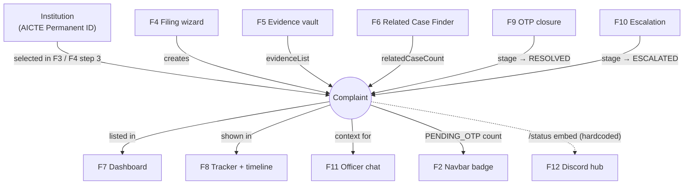
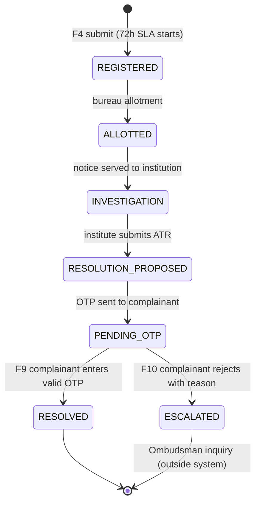
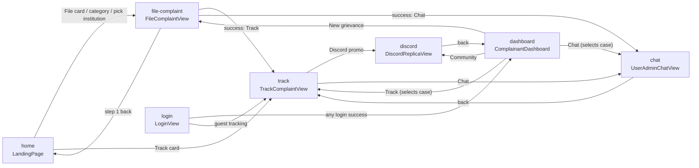

# 04 · How the features relate

Feature IDs (F1–F15) refer to [03-features.md](03-features.md).

## 1. The complaint is the central object

Almost every feature reads or changes a `Complaint`:

## 2. Complaint lifecycle (state machine)

| Transition | Who triggers it | Implemented where |
|---|---|---|
| → REGISTERED | Complainant | FE `handleSubmitFinal`; BE `POST /api/grievances` |
| REGISTERED → … → PENDING_OTP | Officials / institute | **Not implemented**; exists only in seed data timelines |
| PENDING_OTP → RESOLVED | Complainant (OTP) | FE `TrackComplaintView.handleVerifyOtp`; BE `verify-closure-otp` |
| PENDING_OTP → ESCALATED | Complainant (reason) | FE `handleEscalateToOmbudsman`; BE `escalate` |

Every transition should append a `TimelineEvent` (actor, role, timestamp, stage). That timeline is the accountability record the problem statement asks for.

Note that neither FE nor BE currently prevents OTP closure or escalation from a stage other than `PENDING_OTP` at the API level; the FE only shows those controls at stage 5.

## 3. Navigation graph

Arrows are `setActiveTab(...)` calls.

Navbar (F2) and footer can reach every tab. HeaderStrip's sign-in goes to `login`.

## 4. Shared state and who touches it

| `App.tsx` state | Written by | Read by |
|---|---|---|
| `complaints` | F4 (add), F9/F10 via `handleUpdateComplaintStage` | F7, F8, F2 badge |
| `selectedComplaint` | F4 (new case), F7 (Track/Chat buttons) | F8 (initial case), F11 |
| `selectedInstForComplaint` | F3 (pick search result) | F4 (preselect step 3) |
| `chatMessages` | F11 | F11 |
| `currentUser` | F13 login, F1 logout | F1 |
| `activeRole` | F1 switch, F13 login | F1 |
| `lang` | F1 | all components (F14) |
| `fontScale`, `highContrast` | F1 | whole document via CSS |
| `institutions` | nobody (constant) | F3, F4 |

## 5. Feature dependency summary

| Feature | Depends on | Enables |
|---|---|---|
| F3 Institution search | `institutions` data | F4 with preselected institution |
| F4 Filing wizard | institutions, categories, F5, F6 | F7, F8, F11 |
| F5 Evidence | F4 step 4 | F8 proofs card, integrity claim |
| F6 Related cases | institution + category of F4 | dashboard pill, joint hearing (future official review) |
| F7 Dashboard | complaints | F8, F11 |
| F8 Tracker | complaints, selection | F9, F10 |
| F9 OTP closure | stage = PENDING_OTP, ATR data | stage RESOLVED, certificate |
| F10 Escalation | stage = PENDING_OTP | stage ESCALATED, Ombudsman |
| F11 Chat | selectedComplaint, assigned officer | — |
| F12 Discord | own mock data | — (only links back) |
| F13 Login | — | currentUser, activeRole |
| F14 i18n | `lang` | every screen |
| F15 Backend | schemas, database | will replace FE mock data once integrated |

## 6. Frontend ↔ backend correspondence

| Frontend action | Backend endpoint that should replace it |
|---|---|
| `mockInstitutions` + `LandingPage.handleSearch` | `GET /api/institutions?search=` |
| `initialComplaints` | `GET /api/grievances` |
| `TrackComplaintView.handleLookup` | `GET /api/grievances/{case_id}` |
| `FileComplaintView.handleSubmitFinal` | `POST /api/grievances` |
| `TrackComplaintView.handleVerifyOtp` | `POST /api/grievances/{id}/verify-closure-otp` |
| `TrackComplaintView.handleEscalateToOmbudsman` | `POST /api/grievances/{id}/escalate` |
| `LoginView.handleSendOtp` / `handleVerifyOtp` | `POST /api/auth/send-otp`, `/api/auth/verify-otp` |
| `LoginView.loginDemoPersona` / `handleOfficialLogin` | `POST /api/auth/login` (`is_demo: true`) |
| `UserAdminChatView.handleSend` | none yet (`ChatMessageRequest` schema exists, no route) |
