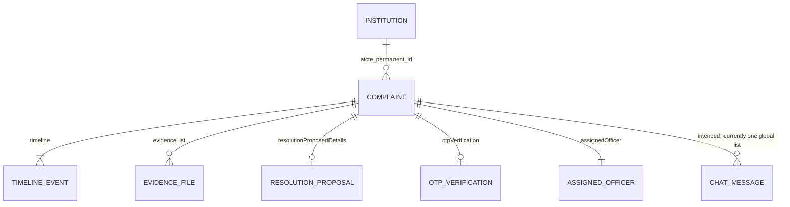

# 07 · Data model

Frontend types live in `frontend/src/types/index.ts`. Backend request models live in `backend/app/schemas.py`; backend stored records are untyped dicts in `backend/app/database.py`.

## Entity relationships



Relations are by embedding (nested objects/arrays) or by matching strings; there are no foreign keys. Related complaints are represented only by a count (`relatedCaseCount`), not by links to other IDs.

## Enums

### `StageKey`

| Key | Stage # | Tracker label | Meaning |
|---|---|---|---|
| `REGISTERED` | 1 | Registered & Hashed | Filed; evidence hashed; 72 h SLA starts |
| `ALLOTTED` | 2 | Bureau Allotment | Routed to a bureau/officer |
| `INVESTIGATION` | 3 | Inquiry & Evidence | Notice served to institution |
| `RESOLUTION_PROPOSED` | 4 | ATR Resolution | Institution submitted Action Taken Report |
| `PENDING_OTP` | 5 | Citizen OTP Verify | Waiting for complainant to accept via OTP |
| `RESOLVED` | 6 | Formally Disposed | Complainant verified; certificate issued |
| `ESCALATED` | — | (red banner) | Complainant rejected; sent to State Technical Ombudsman |

### `GrievanceCategory`

| Key | Label in wizard | Routing note |
|---|---|---|
| `FEES_REFUND` | Fee Refund & Excess Charges | |
| `ANTI_RAGGING` | Anti-Ragging & Harassment | "24h FIR mandatory" |
| `SCHOLARSHIP_AICTE` | AICTE Pragati / Saksham / PMSSS | |
| `SEXUAL_HARASSMENT` | Internal Complaints Committee (ICC) | Strict confidential routing |
| `FACULTY_INFRA` | Faculty & Lab Infrastructure | |
| `ADMISSION_EXAM` | Admissions, Marks & Certificates | |
| `OTHER_UNSURE` | Other / I am not sure | Triage desk routes it |

## Frontend types

### `Complaint`

| Field | Type | Notes |
|---|---|---|
| `id` | string | `AICTE-2026-GRV-NNNNN` |
| `title`, `details` | string | |
| `category` | `GrievanceCategory` | |
| `categoryLabel` | string | Display label |
| `institutionName`, `aictePermanentId`, `city`, `state` | string | Copied from the chosen `Institution` |
| `complainantName` | string | "Confidential Complainant" if anonymous |
| `complainantRole` | `'Student' \| 'Faculty' \| 'Parent' \| 'Anonymous'` | |
| `contactMobile`, `contactEmail` | string | |
| `isAnonymous` | boolean | |
| `currentStage` | `StageKey` | |
| `stageNumber` | number | 1–6 |
| `slaHoursRemaining` | number | Static number, not a countdown |
| `assignedOfficer` | `{ name, designation, bureau, badgeVerified }` | |
| `resolutionProposedDetails?` | `{ atrSummary, proposedRemedy, refundAmount?, officialOrderRef, proposedAt }` | Present from stage 4 |
| `otpVerification?` | `{ generatedOtp, isVerified, verifiedAt?, citizenFeedback?, rating? }` | |
| `evidenceList` | `EvidenceFile[]` | |
| `timeline` | `TimelineEvent[]` | Chronological |
| `relatedCaseCount?` | number | Signature-feature placeholder |

### `EvidenceFile`
`id, name, size (bytes), type (MIME), sha256Hash, uploadDate, previewUrl?`

### `TimelineEvent`
`id, title, description, actor, role, timestamp (display string), stage: StageKey`

### `Institution`
`id, permanentId, name, state, city, category ('Technical' | 'Management' | 'Pharmacy' | 'Architecture'), openCasesCount, complianceRating`

### `UserAdminMessage`
`id, senderRole ('complainant' | 'officer' | 'system'), senderName, senderAvatar?, content, timestamp, attachmentName?, isOfficialNote?`

### Discord types
- `DiscordServer`: `id, name, iconText, unreadCount?, category`
- `DiscordChannel`: `id, serverId, name, type ('text' | 'voice'), description?`
- `DiscordMessage`: `id, channelId, author { name, roleTag, roleColor, avatarBg }, timestamp, content, embedCard? { title, description, color, fields? }`
- `DiscordMember`: `id, name, roleTag, roleColor, isOnline, statusText?`

### Other UI types
- `ActiveTab` (in `components/Navbar.tsx`): `'home' | 'dashboard' | 'file-complaint' | 'track' | 'chat' | 'discord' | 'login'`
- `Language` (in `locales/translations.ts`): `'en' | 'hi'`
- Current user (inline type in `App.tsx`): `{ name, role, institution?, rollOrId?, mobile? }`

## Backend grievance object

Same shape as `Complaint`, in snake_case:

| Frontend (camelCase) | Backend (snake_case) |
|---|---|
| `categoryLabel` | `category_label` |
| `institutionName` | `institution_name` |
| `aictePermanentId` | `aicte_permanent_id` |
| `complainantName` / `complainantRole` | `complainant_name` / `complainant_role` |
| `contactMobile` / `contactEmail` | `contact_mobile` / `contact_email` |
| `isAnonymous` | `is_anonymous` |
| `currentStage` / `stageNumber` | `current_stage` / `stage_number` |
| `slaHoursRemaining` | `sla_hours_remaining` |
| `assignedOfficer.badgeVerified` | `assigned_officer.badge_verified` |
| `resolutionProposedDetails.{atrSummary, proposedRemedy, refundAmount, officialOrderRef, proposedAt}` | `resolution_proposed_details.{atr_summary, proposed_remedy, refund_amount, official_order_ref, proposed_at}` |
| `otpVerification.{generatedOtp, isVerified, verifiedAt, citizenFeedback, rating}` | `otp_verification.{generated_otp, is_verified, verified_at, citizen_feedback, rating}` |
| `evidenceList[].{sha256Hash, uploadDate}` | `evidence_list[].{sha256_hash, upload_date}` |
| `relatedCaseCount` | `related_case_count` |

Backend institution: `id, permanent_id, name, city, state, category, open_cases_count, compliance_rating`.

Differences to resolve during integration:
- Anonymous name: FE uses "Confidential Complainant", BE uses "Anonymous Whistleblower".
- FE complainant role becomes `'Anonymous'` when anonymous; BE keeps the submitted role.
- Officer bureau string: FE seed "AICTE Head Office, New Delhi" vs new-case "AICTE HQ New Delhi" (both sides use both).
- BE seed has 1 grievance; FE seed has 3.

A simple approach is either a camel↔snake converter in the frontend API client, or Pydantic response models with `alias_generator=to_camel` and `populate_by_name=True` on the backend.

## Seed data summary

See [CONTEXT.md §5](CONTEXT.md#5-fixed-demo-data-do-not-need-to-search-for-these) for the full table of institutions, complaints, users, and OTPs.

The flagship demo case **`AICTE-2026-GRV-84920`** (identical on FE and BE): Aarav Sharma (Student, DTU) surrendered his seat on 14 Aug 2026 before the cutoff; the college deducted ₹45,000 against the AICTE refund rule capping processing fees at ₹1,000. Timeline: registered (16 Aug) → allotted to PGRC (16 Aug) → notice served (18 Aug) → ATR with ₹44,000 refund, UTR `SBIN202609148201`, order `DTU/ACAD/REFUND/2026/894-B` (24 Oct) → pending OTP (24 Oct). Two evidence files. Related cases: 3. OTP `849210`.

## Proposed persistent schema (PostgreSQL)

For when the in-memory stores are replaced:

```sql
institutions(id PK, permanent_id UNIQUE, name, city, state, category, region)
users(id PK, name, role, mobile, email, institution_id FK NULL)
grievances(id PK, title, details, category, institution_id FK, complainant_id FK NULL,
           is_anonymous, current_stage, stage_number, sla_due_at TIMESTAMPTZ,
           assigned_officer_id FK, created_at, updated_at)
timeline_events(id PK, grievance_id FK, title, description, actor_id FK, actor_role,
                stage, created_at)
evidence_files(id PK, grievance_id FK, name, size, mime, sha256, storage_key, uploaded_at)
resolution_proposals(id PK, grievance_id FK, atr_summary, remedy, refund_amount,
                     order_ref, proposed_by FK, proposed_at)
closure_verifications(grievance_id PK FK, otp_hash, verified_at, feedback, rating)
case_links(id PK, grievance_id FK, related_grievance_id FK, score, reasons JSONB,
           status ('suggested'|'confirmed'|'rejected'), reviewed_by FK, reviewed_at)
messages(id PK, grievance_id FK, sender_id FK, sender_role, content, attachment_key, created_at)
```

`case_links` turns the related-case count into real, reviewable relationships; `sla_due_at` turns the static SLA number into a real deadline that dashboards can query.
