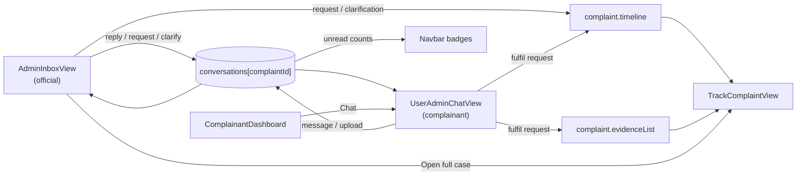

imp# 12 · Admin Panel: Messages / Support Inbox (implementation plan)

**Status:** Implemented on 2026-10-25 (steps 1–6 and 8). Step 7 (frontend calling the backend routes) waits for plan Phase 2. Verified with a headless-browser run of the demo flow (41 checks) and curl against every new route.

**Differences from the original design**
- Selection is stored as `selectedComplaintId` in `App` (not an object), so the tracker, chat and inbox always show live data. This also fixed gaps B1 and B2.
- `appendTimelineEvent` became the module helper `withTimelineEvent` plus `NewTimelineEvent` in `types/index.ts`; `handleUpdateComplaintStage` takes an optional event.
- Bubbles and request cards live in one shared component, `components/chat/MessageThread.tsx` (instead of separate `MessageBubble` / `DocumentRequestCard` files).
- Hashing helper is `lib/evidence.ts` (real SHA-256); the filing wizard still uses its old random hash.
- Inbox, chat and tracker share one selection, so the case chosen in the inbox is also the one opened in the complainant chat.
- Officer messages use the logged-in official's name when one is signed in, otherwise the case's assigned officer.
- Backend `ChatMessageRequest.kind` excludes `document_submission` (submissions only go through the fulfil route); complainants get 403 for clarifications and document requests.

## 1. Requirements

| # | Requirement | Acceptance criteria |
|---|---|---|
| R1 | Admin sees incoming messages in a Messages / Support Inbox | An official sees one row per complaint conversation, with unread count, last message preview, time, stage and SLA. Unread threads sort first. A badge in the navbar shows total unread. |
| R2 | Admin opens the relevant complaint and conversation | Clicking a row opens the thread next to a complaint summary panel (ID, title, complainant, institution, stage, SLA, evidence, recent timeline). "Open full case" goes to the tracker for that case. Opening a thread marks it read. |
| R3 | Admin replies, requests documents, or gives clarification | The composer has three modes: **Reply** (normal message), **Request documents** (checklist of document types + note + due date), **Clarification** (shown as an "Official Remark"). The complainant sees a document request as a card with an upload button; once they upload, the request shows as fulfilled. |
| R4 | The conversation stays linked to the complaint | Every message carries `complaintId`. Each complaint has its own thread. Document requests, uploads and clarifications add events to the complaint's timeline, and uploaded files are added to its evidence list. |

"Admin" here means the **AICTE official** persona (Dr. Ramesh Chandra Verma, PGRC). Nodal officers and bureau-level filtering are out of scope for this plan (see §9).

## 2. What exists today (starting point)

| Item | Current state | Problem for this feature |
|---|---|---|
| `UserAdminMessage` type (`types/index.ts`) | `id, senderRole, senderName, senderAvatar?, content, timestamp, attachmentName?, isOfficialNote?` | No `complaintId`, no message type, no read state |
| `App.chatMessages` | One flat array for all complaints | Not linked to a complaint (gap B7 in [11](11-known-gaps-and-roadmap.md)) |
| `initialChatMessages` (`mockData.ts`) | 5 messages, all about `AICTE-2026-GRV-84920` | Only one conversation to show in an inbox |
| `UserAdminChatView.tsx` | Complainant side; after 1.8 s posts a random canned officer reply | Canned replies would conflict with real admin replies |
| `activeRole` in `App.tsx` | `'complainant' \| 'official'`, set by header switch and login | Changes nothing in the UI today |
| Navbar | Fixed tab list; Chat tab has a static "Live" chip | No role-specific tabs, no unread badge |
| Backend | `ChatMessageRequest` schema exists in `schemas.py` | No message routes, no message storage |

## 3. Design

### 3.1 Data model changes (`frontend/src/types/index.ts`)

```ts
export type MessageKind =
  | 'text'               // normal reply from either side
  | 'clarification'      // official remark from admin
  | 'document_request'   // admin asks for files
  | 'document_submission'// complainant answers a request with files
  | 'system';            // automated notices

export interface DocumentRequest {
  id: string;                 // e.g. 'docreq-1730000000000'
  items: string[];            // e.g. ['Bank statement (Aug 2026)', 'Seat surrender receipt']
  note?: string;
  dueDate?: string;           // display string, like other dates in the app
  status: 'pending' | 'fulfilled';
  fulfilledAt?: string;
  fulfilledFileIds?: string[];// EvidenceFile ids added to the complaint
}

export interface UserAdminMessage {
  id: string;
  complaintId: string;                 // NEW: link to complaint
  kind: MessageKind;                   // NEW (replaces isOfficialNote; keep isOfficialNote for now)
  senderRole: 'complainant' | 'officer' | 'system';
  senderName: string;
  senderAvatar?: string;
  content: string;
  timestamp: string;
  attachmentName?: string;
  attachments?: EvidenceFile[];        // NEW: files sent in this message
  documentRequest?: DocumentRequest;   // NEW: only when kind === 'document_request'
  replyToRequestId?: string;           // NEW: only when kind === 'document_submission'
  isOfficialNote?: boolean;
  readByOfficer: boolean;              // NEW
  readByComplainant: boolean;          // NEW
}

export type ConversationMap = Record<string, UserAdminMessage[]>; // key = complaint id
```

Read state is two booleans because there are exactly two parties. A message written by one side starts as read for that side and unread for the other.

### 3.2 State changes (`frontend/src/App.tsx`)

| Change | Detail |
|---|---|
| `chatMessages: UserAdminMessage[]` → `conversations: ConversationMap` | Seeded from `initialConversations` |
| `handleSendMessage(msg)` → `handleSendMessage(complaintId, msg)` | Appends to `conversations[complaintId]` |
| New `handleMarkThreadRead(complaintId, reader: 'officer' \| 'complainant')` | Sets the matching read flag on every message in the thread |
| New `handleRequestDocuments(complaintId, request, note)` | Adds a `document_request` message and a timeline event "Documents requested by …" |
| New `handleFulfillDocumentRequest(complaintId, requestId, files)` | Adds a `document_submission` message, marks the request `fulfilled`, appends `files` to `complaint.evidenceList`, adds timeline event "Requested documents submitted" |
| New `handleAddClarification(complaintId, text)` | Adds a `clarification` message and a timeline event "Clarification issued" |
| New derived `officerUnreadCount`, `complainantUnreadCount` | Sum of unread messages for each side; passed to Navbar |
| New `selectedConversationId` (or reuse `selectedComplaint`) | Reuse `selectedComplaint` so "open chat" and "open case" always refer to the same complaint |
| Timeline helper | Add `appendTimelineEvent(complaintId, event)` used by the handlers above; this also fixes gap B1 for escalation and OTP closure |

### 3.3 New screen: `views/AdminInboxView.tsx`

New `ActiveTab` value `'admin-inbox'`. Three-column layout on desktop, stacked on mobile (≤ 768 px: list → thread, with a back button).

```
┌──────────────────────┬─────────────────────────────────┬──────────────────────┐
│ CONVERSATION LIST    │ THREAD                          │ COMPLAINT PANEL      │
│ [Search case/name ]  │ AICTE-2026-GRV-79114 · Pooja K. │ Stage 3 Inquiry      │
│ All|Unread|Awaiting  │ ─────────────────────────────── │ SLA 41h left         │
│ reply|Docs pending   │ (messages, request cards,       │ COEP Tech · 1-2948…  │
│                      │  submissions, remarks)          │ Category: Scholarship│
│ ● 79114  Pooja K. 2  │                                 │ Evidence (1)         │
│   "PFMS status still │                                 │ Last 3 timeline evts │
│   frozen…"   10:40   │ ─────────────────────────────── │ [Open full case →]   │
│   84920  Aarav S.    │ [Reply|Request docs|Clarify]    │ Pending requests (1) │
│   65021  Rohan D.    │ [ type message…        ][Send]  │                      │
└──────────────────────┴─────────────────────────────────┴──────────────────────┘
```

| Part | Behaviour |
|---|---|
| Conversation list | One row per complaint that has messages (all complaints for the demo). Shows unread dot + count, complainant name (masked if `isAnonymous`), case ID, last message preview, time, stage chip. Filters: All · Unread · Awaiting reply (last message from complainant) · Docs pending (any `pending` request). Search on case ID, name, institution. |
| Thread | Same bubble styles as the complainant chat. `document_request` renders as a card listing items, due date and status. `document_submission` shows the files with hash. `clarification` shows the "Official Remark" tag. Opening the thread calls `handleMarkThreadRead(id, 'officer')`. |
| Composer | Mode tabs. **Reply:** text. **Request documents:** checkboxes for common items (fee receipt, bank statement, ID proof, admission letter, seat surrender acknowledgement, other: free text), note, due date (default +3 days). **Clarification:** text, sent as official remark. Quick reply templates per mode. |
| Complaint panel | Read-only summary from the `Complaint`. "Open full case" → `setSelectedComplaint` + `setActiveTab('track')`. |

### 3.4 Complainant side changes (`views/UserAdminChatView.tsx`)

- Take `messages` for the selected complaint only and `complaintId` for sending.
- **Remove the simulated officer auto-reply** (`setTimeout` + canned replies). Replies now come from the admin inbox. For a one-person demo, switch the header role pill to "AICTE Official" to answer.
- Render `document_request` cards with an **Upload requested documents** button. It uses a file input, hashes the files the same way as the filing wizard (real SHA-256 once plan step 1.1 is done), then calls `handleFulfillDocumentRequest`.
- Replace the paperclip `alert` with a real file picker that attaches files to a `text` message (also added to evidence).
- On open, call `handleMarkThreadRead(id, 'complainant')`.

### 3.5 Role-aware navigation (`components/Navbar.tsx`)

- Accept `activeRole`, `officerUnreadCount`, `complainantUnreadCount` props.
- When `activeRole === 'official'`: show **Support Inbox** tab (`admin-inbox`) with unread badge; hide **File Complaint**.
- When `activeRole === 'complainant'`: Chat tab shows unread badge instead of the static "Live" chip.
- `HeaderStrip`: remove the `alert` on switching to official and jump to `admin-inbox` instead.
- `LoginView`: officer login and the "AICTE Officer" quick-login land on `admin-inbox`.

This is a first step toward plan item 3.5 ("make the role switch real") in [08](08-implementation-steps.md).

### 3.6 Seed data (`frontend/src/data/mockData.ts`)

Replace `initialChatMessages` with `initialConversations: ConversationMap`:

| Complaint | Thread content | Shows in demo |
|---|---|---|
| `AICTE-2026-GRV-84920` (Aarav) | The existing 5 messages, all read | Read thread, OTP stage |
| `AICTE-2026-GRV-79114` (Pooja) | Officer `document_request` for "PFMS Aadhaar-seeding confirmation" + "Bank passbook first page", still **pending**; then 2 unread complainant messages asking about the status | Unread + docs pending; demo of fulfilment |
| `AICTE-2026-GRV-65021` (Rohan) | Short closed conversation ending with a system message about resolution | Resolved thread |

Seed messages get `complaintId`, `kind`, and read flags.

### 3.7 Translations (`locales/translations.ts`)

Add `en` and `hi` keys: `navInbox`, `inboxTitle`, `inboxSearch`, `filterAll`, `filterUnread`, `filterAwaiting`, `filterDocsPending`, `modeReply`, `modeRequestDocs`, `modeClarify`, `requestDocsTitle`, `dueDate`, `uploadRequested`, `requestPending`, `requestFulfilled`, `openFullCase`, `noConversation`.

### 3.8 Backend (`backend/`)

Storage in `app/database.py`:
```python
mock_messages: Dict[str, List[Dict[str, Any]]] = { "AICTE-2026-GRV-84920": [ ... ] }
```

Schemas in `app/schemas.py` (extend the unused `ChatMessageRequest`):
```python
class DocumentRequestIn(BaseModel):
    items: List[str]
    note: Optional[str] = None
    due_date: Optional[str] = None

class ChatMessageRequest(BaseModel):
    sender_role: Literal["complainant", "officer", "system"]
    sender_name: str
    content: str
    kind: Literal["text", "clarification", "document_request", "document_submission"] = "text"
    document_request: Optional[DocumentRequestIn] = None
    reply_to_request_id: Optional[str] = None
    attachments: List[EvidenceUploadItem] = []

class MarkReadRequest(BaseModel):
    reader_role: Literal["officer", "complainant"]
```
(`case_id` moves to the path.)

Routes in `main.py`:

| Method | Path | Purpose |
|---|---|---|
| GET | `/api/inbox?filter=all\|unread\|awaiting\|docs_pending&search=` | One summary per conversation: `case_id, title, complainant_name (masked), institution_name, current_stage, sla_hours_remaining, last_message, last_message_at, unread_for_officer, pending_requests` |
| GET | `/api/grievances/{case_id}/messages` | Full thread |
| POST | `/api/grievances/{case_id}/messages` | Send any message kind; for `document_request` creates the request; appends timeline event where relevant |
| POST | `/api/grievances/{case_id}/messages/read` | Mark thread read for one side |
| POST | `/api/grievances/{case_id}/document-requests/{request_id}/fulfill` | Body: `attachments`. Marks fulfilled, adds files to `evidence_list`, adds timeline event |

404 if the case doesn't exist; 409 when fulfilling a request that is already fulfilled.

The frontend keeps working on local state for the demo; switching it to these routes is part of plan Phase 2 ([08](08-implementation-steps.md#phase-2--connect-frontend-and-backend)).

## 4. How it connects to existing features



## 5. Implementation steps

Each step should leave the app building (`npm run build`) and demoable.

### Step 1 · Link messages to complaints (foundation)
- [x] Add `MessageKind`, `DocumentRequest`, new `UserAdminMessage` fields, `ConversationMap` to `types/index.ts`.
- [x] Convert `initialChatMessages` → `initialConversations` with three threads (§3.6).
- [x] In `App.tsx`: `conversations` state, `handleSendMessage(complaintId, msg)`, `handleMarkThreadRead`, `appendTimelineEvent`.
- [x] Update `UserAdminChatView` to read `conversations[complaint.id]` and send with `complaintId`.
- **Done when:** each complaint's chat shows only its own messages; build passes. Fixes gap B7.

### Step 2 · Admin inbox list + thread (R1, R2)
- [x] Add `'admin-inbox'` to `ActiveTab`; render branch in `App.tsx`.
- [x] Create `views/AdminInboxView.tsx`: conversation list with filters/search, thread pane, complaint panel, "Open full case".
- [x] Mark thread read on open; compute `officerUnreadCount`.
- **Done when:** an official sees 3 conversations, 79114 shows 2 unread, opening it clears the count, "Open full case" shows that case in the tracker.

### Step 3 · Composer modes (R3)
- [x] Reply mode (text + quick templates).
- [x] Clarification mode → `clarification` message + timeline event.
- [x] Request documents mode → `document_request` message with checklist/note/due date + timeline event.
- **Done when:** each mode produces the right message type, visible to the complainant, and the tracker timeline shows the request/clarification.

### Step 4 · Complainant fulfils requests (R3, R4)
- [x] Render request cards in `UserAdminChatView` with an upload button.
- [x] `handleFulfillDocumentRequest`: submission message, request → fulfilled, files → `evidenceList`, timeline event.
- [x] Replace the paperclip `alert` with a real file picker.
- [x] Remove the simulated officer auto-reply.
- **Done when:** uploading on a pending request flips it to fulfilled in both views, and the file appears in the tracker's "Stored Proofs".

### Step 5 · Role-aware navigation
- [x] Navbar: role-specific tabs and unread badges.
- [x] HeaderStrip: switching to official opens the inbox (no `alert`).
- [x] LoginView: officer logins land on the inbox.
- [x] Translations for all new strings (§3.7).
- **Done when:** switching the role pill changes the tabs; badges update live as messages are sent from the other side.

### Step 6 · Backend endpoints
- [x] `mock_messages` seed data matching the frontend threads (only the 84920 thread, because the backend seed has only that grievance).
- [x] Schemas (§3.8) and 5 routes.
- [x] Verify each route with `curl` (commands added to [06](06-api-reference.md)).
- **Done when:** every route returns the documented shape; fulfilling twice returns 409.

### Step 7 · Integrate (with plan Phase 2)
- [ ] Add inbox/message functions to the planned `frontend/src/lib/api.ts`.
- [ ] Inbox and chat load from the API when available, falling back to local state.

### Step 8 · Docs
- [x] Update `CONTEXT.md`, `03-features.md` (new feature F16 Support Inbox; F11 chat no longer simulated), `04-feature-relationships.md`, `05-file-reference.md`, `06-api-reference.md`, `07-data-model.md`, status table in `01-project-overview.md`, remove B7 from `11-known-gaps-and-roadmap.md`, demo script in `09-setup-and-demo.md`, `CHANGELOG.md`, and tick the boxes in this file.

Steps 1–5 are frontend only and give the full demo. Step 6 can be built in parallel by a second person.

## 6. Files touched

| File | Change |
|---|---|
| `frontend/src/types/index.ts` | New types/fields |
| `frontend/src/data/mockData.ts` | `initialConversations` |
| `frontend/src/App.tsx` | State, handlers, render branch, props |
| `frontend/src/views/AdminInboxView.tsx` | **New** |
| `frontend/src/views/UserAdminChatView.tsx` | Per-case thread, request cards, uploads, remove canned replies |
| `frontend/src/components/Navbar.tsx` | `ActiveTab`, role-aware tabs, badges |
| `frontend/src/components/HeaderStrip.tsx` | Role switch opens inbox |
| `frontend/src/views/LoginView.tsx` | Officer login destination |
| `frontend/src/locales/translations.ts` | New keys (en + hi) |
| `backend/app/database.py` | `mock_messages` |
| `backend/app/schemas.py` | Message schemas |
| `backend/main.py` | 5 routes |
| `docs/*` | Step 8 |

The request card and message bubble will be needed in both chat views. To avoid duplicating them, put them in `frontend/src/components/chat/MessageBubble.tsx` and `DocumentRequestCard.tsx`, with styles in the same inline `<style>` pattern the rest of the app uses.

## 7. Demo flow (adds ~1 minute)

1. Header pill → **AICTE Official**. The navbar shows **Support Inbox (2)**.
2. Open **79114 · Pooja Kulkarni**: unread messages, a pending document request, complaint panel on the right.
3. Send a **Clarification**: "PFMS freeze is on the institute's side; nodal officer has been notified."
4. Switch to **Complainant**, open 79114 from the dashboard → Chat. The request card is there; upload a file. It shows as fulfilled.
5. Switch back to **Official**: the request is fulfilled; **Open full case** → the tracker shows the new evidence file and timeline events.

Pitch line: "Every message, document request and upload is attached to the complaint and written to its audit trail. Nothing lives in personal email."

## 8. Testing checklist

- [x] Each complaint's thread only shows its own messages, in both views.
- [x] Unread counts: increase when the other side sends, clear when the thread is opened, never negative.
- [ ] Anonymous complaints show a masked name in the inbox.
- [x] Request → fulfil → evidence and timeline updated; a second fulfil is blocked. (UI blocks a second upload; backend returns 409)
- [x] Switching roles mid-flow keeps all state.
- [x] Mobile layout (≤ 768 px): list → thread → back works.
- [ ] Keyboard: tab through list, open with Enter, composer reachable; new messages announced via `aria-live="polite"`.
- [x] Hindi toggle covers all new strings. Hindi covers the new inbox/chat strings; some fixed English remains (stage labels, document types, quick replies).
- [x] `npm run build` and `npm run lint` pass. Build passes; lint has warnings only (mostly pre-existing).
- [x] Backend: all 5 routes return the documented shapes and errors.

## 9. Out of scope / later

- Inbox filtered by the official's bureau, and access control so officials only see assigned cases (needs Phase 4 auth).
- ICC (`SEXUAL_HARASSMENT`) threads visible only to ICC officers.
- Nodal-officer participation in threads.
- Transfer a conversation to another officer/bureau.
- SMS/email notification when a document is requested, and overdue reminders on `dueDate`.
- Real-time delivery (WebSocket/SSE). In-memory state is enough for the single-browser demo.
